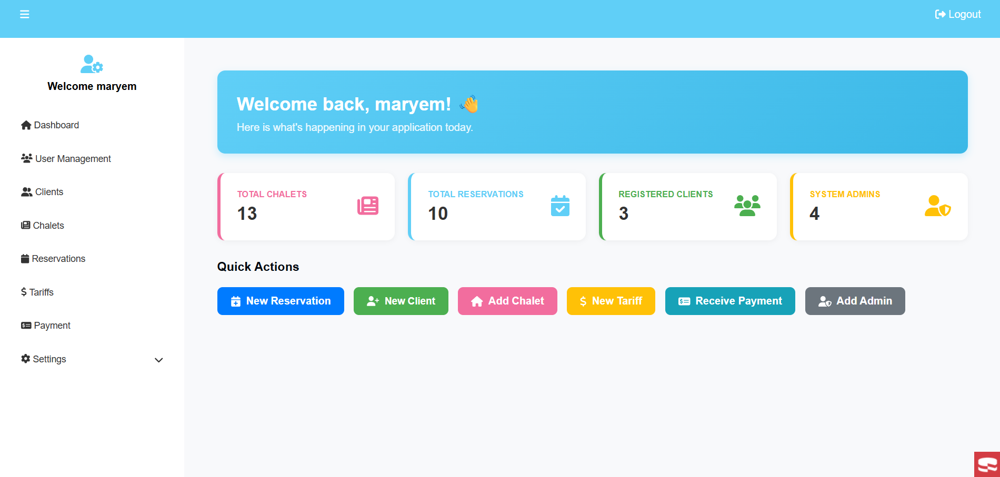
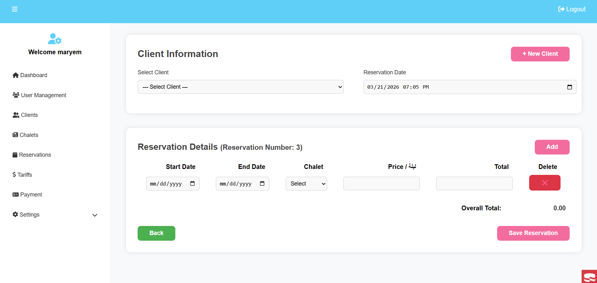
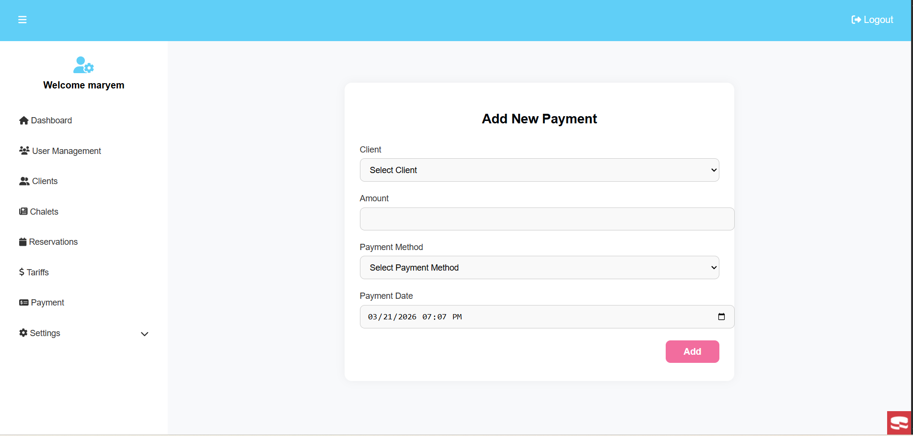
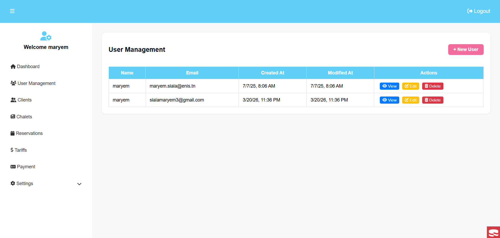

# Chalet Reservation System

Welcome to the Chalet Reservation System! This application allows you to manage chalets, track reservations, and view an interactive dashboard.

## Screenshots

Here is a glimpse of the system in action:

### Dashboard


### Add Reservation


### Add Payment


### User Management


---

## Installation & Setup

1. Clone the repository:
   ```bash
   git clone <your-github-repo-url>
   ```

2. Install dependencies using Composer:
   ```bash
   composer install
   ```

3. Configure your environment:
   - Copy `config/app_local.example.php` to `config/app_local.php`.
   - Update your database credentials in `config/app_local.php`.

4. Run the development server:
   ```bash
   bin/cake server
   ```

Then visit `http://localhost:8765` to see the application.
